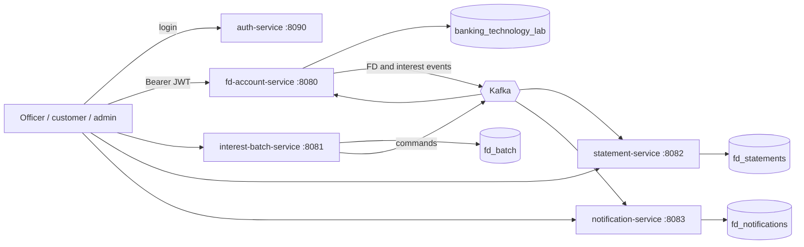

# Fixed Deposit (FD) Module - Group 9

Banking Technology Lab [CSF 3142], MIT Manipal, 2026-27. A microservices, event-driven FD platform: open an FD with a double-entry ledger, accrue and pay interest daily, handle maturity and premature withdrawal, send e-mail / WhatsApp alerts, produce reports, and secure everything with JWT login.

**Stack:** Java 25, Spring Boot 4.1.1, MySQL 8.4, Apache Kafka 4.3 (KRaft), Angular (interest dashboard), Docker.
**State of the code:** 148 automatic tests pass (`.\mvnw.cmd -B clean package`), and an 84-check end-to-end test passes against the real MySQL + Kafka stack, both with services run from jars and as Docker containers (`scripts\lifecycle-test.ps1`).

## The team and what each member built

Assignments follow the "Group 9" tab of the work-distribution sheet. "Not in this repository" means the part exists nowhere in this code base (for example the Angular screens).

| Member | Assignment | What exists in the code | Where to look | Tests | Docs |
| --- | --- | --- | --- | --- | --- |
| **Vritika Vinod** | L12/L13: `fd_accounts` schema, account-number generator, FD creation API, product and category validation, creation UI | `POST /api/fd/account/create`, `GET /api/fd/account/{n}`. Account number = branch code + 6-digit sequence + check digit. Validation: product exists, ACTIVE, effective date reached, term within the product's range, minimum deposit. Rate = product minimum rate, plus 1% for a SENIOR customer, capped by the product's add-on cap and maximum rate. **Creation UI: not in this repository.** | `fd-account-service`: `FDAccountController`, `FDAccountService`, `FDAccountNumberGenerator`, `ProductValidationService`, `RateService`, entities `FixedDepositAccount` / `Product` / `CustomerProfile`; `sql/l12_l13_setup.sql` | shared with Anirudh: the original 21 tests, plus `ProductValidationServiceTest` (3) added during integration | `fd-account-service/README.md` |
| **Anirudh Syam Menon** | L16: `fd_transactions` schema, initial-deposit logging (`@Transactional`), double-entry GL, success response and transaction-history link | `POST /api/fd/account/create-with-txn` creates the account and its DEPOSIT row in one transaction (rolls back together). `GET /api/fd/account/{n}/transactions`. Every ledger row has a debit and a credit GL account (`GLAccounts`). One DEPOSIT per FD is enforced by the database. **Success / history UI: not in this repository.** | `FDTransactionService`, `FDTransactionController`, `FDTransaction`, `GLAccounts`; `sql/l16_fd_transactions.sql` | `FDTransactionServiceTest` (6), `FDTransactionApiIntegrationTest` (14), `FDTransactionRollbackIntegrationTest` (1) | `fd-account-service/docs/LAB16_HANDOVER.md` and the Word report beside it |
| **Parth Gupta** | L14/L17: interest engine (simple, monthly compound), 03:00 daily batch scheduler, statement service, interest/statement dashboard | `InterestEngine` (SIMPLE `P*r*months/1200`, MONTHLY_COMPOUND). Daily posting ACTUAL/365, six-decimal accrual. `interest-batch-service` runs the 03:00 IST job and admin batch requests; `statement-service` builds statements from Kafka events; Angular dashboard on port 4200. Parth also built the Kafka outbox / retry / dead-letter library the whole platform uses. | `fd-account-service/.../interest`, `interest-batch-service`, `statement-service`, `event-common`, `interest-dashboard` | `InterestEngineTest` (5), `InterestPostingIntegrationTest` (8), `BatchIntegrationTest` (5), `StatementIntegrationTest` (6), event-common (8) | `docs/HANDOVER.md`, `docs/Parth_L14_L17_Interest_Statements_Handover_Report.docx`, `docs/PARTH_L14_L17_README.md`, `docs/test-evidence/` |
| **Niranjan Subhash Nair** | Accrued interest and penalty logic, pre-maturity withdrawal API, status / log update, withdrawal UI | `GET /api/fd/account/{n}/withdrawal-inquiry` (a quote that writes nothing: it runs the real withdrawal and rolls it back) and `POST /api/fd/account/{n}/withdrawal`. Penalty = interest earned x the product's penalty %. Payout = principal + interest - penalty. Ledger: INTEREST, PENALTY_DEBIT, PREMATURE_WITHDRAWAL. Status becomes PREMATURELY_CLOSED. Rejects matured, already-closed, unknown and on/after-maturity FDs. **Withdrawal UI: not in this repository.** The missing customer-ownership check was added later (see Krishna). | `fd-account-service/.../withdrawal` (`WithdrawalService`, `WithdrawalController`) | `WithdrawalIntegrationTest` (6) | `docs/HANDOVER.md` ("Premature withdrawal") |
| **Pratham P Shetty** | Maturity batch (04:00), fund transfer, manual closure, maturity GL entries | `MaturityService` runs at 04:00 IST and on demand (`POST /api/fd/maturity/run`, ADMIN). For each due ACTIVE FD, under a row lock: catch up interest, pay it, pay the principal (MATURITY_PAYOUT), set MATURED, publish `FdMatured`. Re-runs and parallel runs pay nothing twice. Fund transfer is **simulated** (payout lands in a settlement GL account). Single-account manual closure is not implemented. Pratham also merged the team repository. | `fd-account-service/.../maturity` | `MaturityIntegrationTest` (12) | `docs/HANDOVER.md` ("Maturity processing") |
| **Krishna Gupta** | E-mail / WhatsApp notifications, FD reporting API (JSON/CSV), time travel and lifecycle tests (E2E scenarios 1-4), integration, JWT, docs | `notification-service` (e-mail via SMTP, WhatsApp via Twilio sandbox, mock by default). Reports in JSON / CSV / PDF / Excel, nightly file extract, Python report. Business clock ("time travel"). `auth-service` + `security-common` (JWT) and customer-ownership checks on every FD endpoint. Docker images + compose. End-to-end lifecycle test, Postman collection. | `notification-service`, `auth-service`, `security-common`, `fd-account-service/.../report`, `.../clock`, `.../security`, `scripts/`, `Dockerfile`, `compose.yaml` | 74 new tests: notification-service 30, reports 15 (CSV writer 5, report API 10), JWT + ownership in fd-account-service 8, security-common 9, auth-service 6, JWT in batch and statement services 6; plus the 84-check end-to-end script | `docs/API_CONTRACTS.md`, `docs/EVENT_CONTRACTS.md`, `docs/ARCHITECTURE_AND_DEPLOYMENT.md`, `STATUS.md` |

(The 148 tests = 71 that existed in the merged repository + 77 added during integration.)

## Architecture



| Service | Port | Database | Purpose |
| --- | --- | --- | --- |
| auth-service | 8090 | none | login, issues JWT |
| fd-account-service | 8080 | `banking_technology_lab` | accounts, ledger, interest, maturity, withdrawal, reports, business clock |
| interest-batch-service | 8081 | `fd_batch` | 03:00 daily interest job, admin batch requests |
| statement-service | 8082 | `fd_statements` | statements from Kafka events |
| notification-service | 8083 | `fd_notifications` | e-mail and WhatsApp alerts from Kafka events |
| event-common, security-common | - | - | shared libraries (outbox/retry/dead-letter; JWT validation) |
| interest-dashboard (Angular) | 4200 | - | interest / batch / statement admin screen (HTTP Basic login) |

Each service owns its database; services talk to each other only through Kafka events (an outbox table guarantees an event is never lost or invented). Details and the event list: `docs/ARCHITECTURE_AND_DEPLOYMENT.md`, `docs/EVENT_CONTRACTS.md`.

## Run it

Prerequisites: Java 25, Docker Desktop, PowerShell. Node 24 + pnpm only for the Angular dashboard.

**Option 1 - everything as containers (the same images you would push to Azure)**
```powershell
$env:JWT_SECRET = '<32+ random characters>'
docker compose --profile full up -d --build
.\scripts\lifecycle-test.ps1                      # on a fresh database: 84 checks
```

**Option 2 - infrastructure in Docker, services from jars (what the scripts use)**
```powershell
copy scripts\local.env.ps1.example scripts\local.env.ps1      # then set DB password and JWT_SECRET
.\mvnw.cmd -B clean package
mkdir artifacts -Force
foreach ($s in 'auth-service','fd-account-service','interest-batch-service','statement-service','notification-service') { copy "$s\target\$s-1.0.0.jar" "artifacts\$s.jar" -Force }
.\scripts\reset-demo.ps1                          # fresh MySQL + Kafka + all five services
.\scripts\lifecycle-test.ps1 -FreshStart          # full end-to-end proof
```
`scripts\stop-services.ps1` stops the services. The business clock only moves forward, so use `reset-demo.ps1` for a clean start.

**Dashboard (optional):** `scripts\build-ui.ps1`, then `node scripts\serve-dashboard.mjs`, open http://localhost:4200 (admin1 / admin123).

## Security

Log in with `POST /api/auth/login` and send `Authorization: Bearer <token>`. Roles: ADMIN, BANK_OFFICER, CUSTOMER. A customer can only reach their own FDs. HTTP Basic demo users (admin1/admin123, officer1/officer123, customer1/customer123) also work and can be switched off. The signing key is the `JWT_SECRET` environment variable only. Full contract and token format: `docs/API_CONTRACTS.md`.

## Documentation map

| File | What it is |
| --- | --- |
| `STATUS.md` | hand-over snapshot: ports, who did what, done vs left, open items for other groups |
| `docs/API_CONTRACTS.md` | every REST endpoint, roles, login, ownership rule, reports |
| `docs/EVENT_CONTRACTS.md` | Kafka topics, event payloads, consumer groups, delivery guarantees |
| `docs/ARCHITECTURE_AND_DEPLOYMENT.md` | diagrams, data model, test plan, Docker, Azure plan, known limitations |
| `docs/HANDOVER.md` | per-person technical handover: interest, maturity, premature withdrawal, notifications and reports |
| `docs/FD-Module.postman_collection.json` | 35 requests with status tests (run the "Auth" folder first) |
| `fd-account-service/docs/LAB16_HANDOVER.md` | Anirudh's L16 handover |
| `fd-account-service/README.md` | Vritika's original L12/L13 standalone README (historical) |
| `docs/PARTH_L14_L17_README.md` | Parth's original README (historical; service count and versions are out of date) |
| `docs/references/` | Swagger, ER diagram, lab reports, onboarding script |
| `docs/test-evidence/`, `docs/*.json` | evidence snapshots from the merged repository (historical: they predate the notification, auth and report services) |

## Known limitations and open items

* **Calculator and Product & Pricing integration is not done.** FD still reads its own `products` table (code `FDSTD`); Group 5's codes are `FD001`/`FD002`, their service also uses port 8080, and their calculator lookup is limited to the caller's own calculations. Details in `STATUS.md`.
* **Screens:** the account-creation, success / transaction-history and withdrawal UIs are not in this repository. Only the interest dashboard exists.
* **Fund transfer is simulated;** payouts are ledger entries to a settlement account.
* **Users:** login uses three demo accounts in `auth-service` until Group 1's customer module is ready. Only `customer1` is linked to a customer profile (`CUST001`).
* **Account numbers** come from an in-memory counter per instance (it skips numbers already used); with several instances running, two could pick the same number at the same moment and the database would reject one.
* **Notifications:** WhatsApp is the Twilio sandbox only; a failed send is recorded but not automatically retried.
* **Azure:** packaged as containers and planned, not deployed.
