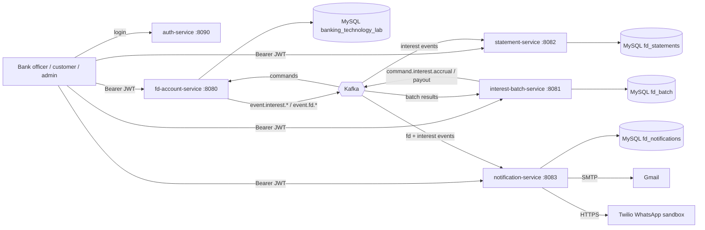
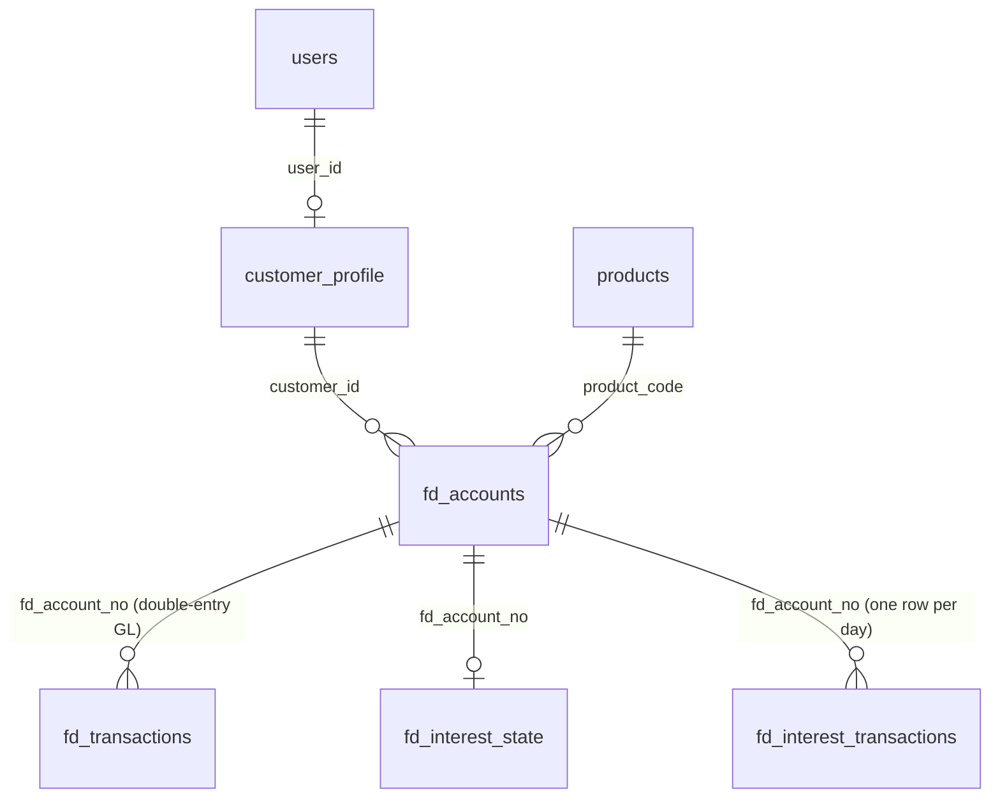

# FD module (Group 9) - architecture, test plan and deployment

Status of this document: everything in sections 1 to 6 describes what is built and was run. Section 7 (Azure) is a **plan**; nothing has been deployed to Azure.

## 1. Architecture

Six deployable pieces. Each service owns its own database, talks to the others only through HTTP (for people) or Kafka events (between services), and can be started, stopped and scaled alone.



| Service | Port | Owns | Job |
| --- | --- | --- | --- |
| auth-service | 8090 | nothing (users are in memory) | checks a password, issues a signed JWT |
| fd-account-service | 8080 | `banking_technology_lab` | accounts, deposit + GL ledger, interest posting, maturity (04:00), premature withdrawal, business clock, reports, nightly extract |
| interest-batch-service | 8081 | `fd_batch` | 03:00 IST daily accrual request + admin batch requests |
| statement-service | 8082 | `fd_statements` | statements built from Kafka interest events |
| notification-service | 8083 | `fd_notifications` | e-mail and WhatsApp alerts from Kafka events |
| security-common (library) | - | - | how tokens are validated and roles read |
| event-common (library) | - | - | outbox, topic list, retry + dead-letter setup |

### Event flow (why it is reliable)

1. A service changes its own database **and** writes the event into an `event_outbox` table in the same transaction.
2. A relay publishes pending outbox rows to Kafka every 3 seconds and marks them published only after Kafka acknowledged. Delivery is therefore *at least once*.
3. Every consumer records the `eventId` it has processed (`consumed_events`), so a replayed event changes nothing.
4. A bad message is retried (1 try + 4 retries, 1 s apart) and then parked in a `<topic>.DLT` dead-letter topic instead of blocking the queue.

Topics: `command.interest.accrual`, `command.interest.payout`, `event.interest.accrued`, `event.interest.paid`, `event.batch.completed`, `event.batch.failed`, `event.fd.created`, `event.fd.matured`, `event.fd.prematurely-closed` (each with `.DLT`; 3 partitions, replication 1 locally). Payloads: `EVENT_CONTRACTS.md`.

### Security

* Login: `POST /api/auth/login` returns an HS256 JWT (`sub`, `roles`, `iss`, `iat`, `exp`, `jti`), the same format the Product and Calculator teams use. Every service validates signature, issuer, expiry and algorithm; `alg:none` and edited tokens are refused (401). Wrong role is 403.
* The signing key is the environment variable `JWT_SECRET` only; with no key a service accepts no tokens (never a built-in default).
* Roles: ADMIN, BANK_OFFICER, CUSTOMER. A CUSTOMER can only reach FDs of the customer profile linked to their login; someone else's FD and an unknown FD both answer 403.
* Five wrong passwords lock a username for 60 s (429). An unknown user and a wrong password give the same 401.
* HTTP Basic demo users remain for the dashboard and quick tests; `APP_SECURITY_BASIC_ENABLED=false` turns them off.
* Money is `DECIMAL` / `BigDecimal` everywhere and is never added across currencies. CSV exports defuse text starting with `= + - @`. Phone numbers and e-mails are masked in the notification log.

## 2. Data model (FD database)



Other tables: `event_outbox`, `processed_interest_requests`, `business_clock` (FD DB); `batch_requests`, `scheduler_guard` (batch DB); `fd_statements`, `consumed_events` (statement DB); `notifications_log`, `notification_contacts`, `consumed_events` (notification DB). There are no foreign keys between databases.

Ledger postings: open FD = DEPOSIT Dr ASSET_CUSTOMER_REMITTANCE / Cr LIABILITY_FD_DEPOSITS; interest paid = INTEREST Dr EXPENSE_INTEREST / Cr ASSET_CUSTOMER_SETTLEMENT; capitalised interest = Dr EXPENSE_INTEREST / Cr LIABILITY_FD_DEPOSITS; maturity = MATURITY_PAYOUT Dr LIABILITY_FD_DEPOSITS / Cr ASSET_CUSTOMER_SETTLEMENT; penalty = PENALTY_DEBIT Dr LIABILITY_FD_DEPOSITS / Cr INCOME_PREMATURE_PENALTY; early payout = PREMATURE_WITHDRAWAL Dr LIABILITY_FD_DEPOSITS / Cr ASSET_CUSTOMER_SETTLEMENT. The end-to-end test checks that the deposit liability nets to exactly zero after maturity and after early closure.

## 3. Test plan and results

| Level | What | Where | Result when last run |
| --- | --- | --- | --- |
| Unit | interest maths, CSV writer, e-mail and WhatsApp channels, message templates, JWT rules | `*Test.java` | pass |
| Integration (H2 + real Spring context + MockMvc) | accounts + ledger, rollback, interest posting, maturity, withdrawal, reports (all formats, role matrix), JWT + ownership, batch, statements, notifications | `*IntegrationTest.java`, `JwtSecurity*Test.java` | pass |
| Kafka transport | outbox -> real embedded Kafka broker -> consumer, DLT, retry | `KafkaDeliveryIntegrationTest`, `OutboxRelayTest` | pass |
| End to end on the real stack (MySQL + Kafka + 5 services) | `scripts/lifecycle-test.ps1 -FreshStart` | scenarios 1 to 4, JWT, role matrix, reports | pass |
| API | Postman collection `FD-Module.postman_collection.json` (35 requests with status tests) | import in Postman | provided |

Run everything: `.\mvnw.cmd -B clean package` (all unit + integration tests), then `.\scripts\lifecycle-test.ps1 -FreshStart`.

The end-to-end script covers: scenario 1 (create, interest accrual + payout, maturity, no double payout on re-run, books balance), scenario 2 (premature withdrawal, penalty equals the quote, payout equals the quote), scenario 3 (matured and closed accounts reject withdrawal and nothing changes), scenario 4 (each notification arrives exactly once on each channel), plus role matrix, JWT (good, wrong, garbage, damaged, edited tokens), ownership, reports (JSON/CSV/PDF/Excel), nightly extract idempotency and the Python report.

### Batch validation and idempotency
* Re-submitting the same batch request id changes nothing; the same id with different content is rejected.
* Re-running the maturity job or the interest payout for a date that is already done posts nothing new.
* The nightly extract for a business date is written once; re-running reports `created:false`.

## 4. Time travel (for demonstrations and tests)

`POST /api/fd/clock/advance {"days":n}` (ADMIN, forward only) moves the *business date* the bank uses for interest, maturity, withdrawal and reports. It is off unless `APP_TIME_TRAVEL_ENABLED=true`. It does not change the computer's clock, the database timestamps or the cron times. Start over with `scripts/reset-demo.ps1`.

## 5. API versioning
APIs are unversioned under `/api/...` (the team's prefix, not Swagger's `/api/v1/...`). Events carry `schemaVersion: 1`; a consumer rejects an unknown version to the dead-letter topic. A breaking change should add `/api/v2/...` and `schemaVersion: 2` while v1 keeps running.

## 6. Known limitations (honest list)
* Fund transfer is simulated (payouts land in `ASSET_CUSTOMER_SETTLEMENT`).
* Users for login are the three demo accounts in `auth-service` until Group 1's customer/login module exists; only `customer1` is linked to a customer profile (`CUST001`).
* The notification e-mail / WhatsApp call happens inside the database transaction of the consumer; a crash right after sending can send the same message twice. A pending-row-then-send design would avoid it.
* Contact details (e-mail, phone) travel inside the `FdCreated` event, which keeps the notification service independent but copies personal data.
* The WhatsApp channel uses the Twilio sandbox: the recipient must join the sandbox first; it is a demo channel, not a production sender.
* FD Calculator and Product & Pricing integration is not done (see `STATUS.md`, "Open items").
* The Angular dashboard still signs in with HTTP Basic.
* Scheduled jobs run on every instance: the 03:00 batch has a database guard, the 04:00 maturity job and the extract are idempotent, the outbox relay is at-least-once with idempotent consumers. The extract folder is local to each instance (use shared storage if scaled out).
* `mysql` / `kafka` in `compose.yaml` are single-node development setups (replication factor 1).

## 7. Deployment

### Containers (built and run locally)
`Dockerfile` builds one small image per service (`--target <service>`, base `eclipse-temurin:25-jre`, non-root user, secrets only as environment variables at run time; `.dockerignore` keeps `scripts/local.env.ps1` out of images).

```powershell
$env:JWT_SECRET = '<32+ random characters>'
docker compose --profile full up -d --build     # MySQL + Kafka + the 5 services
```

### Azure plan (not deployed; check current prices and your student credit before creating anything)
| Piece | Azure service | Notes |
| --- | --- | --- |
| Images | Azure Container Registry | `az acr build` can build straight from the Dockerfile |
| Five services | Azure Container Apps (or App Service for Containers) | one app per service; set min replicas 1; ingress external only for fd-account-service and auth-service if the UI needs it |
| MySQL | Azure Database for MySQL - Flexible Server | the stack is MySQL, so *not* Azure SQL as the lab manual's sample says; one server, four databases; run the SQL scripts in `fd-account-service/sql/` once |
| Kafka | a Kafka container with a volume, or Azure Event Hubs (Kafka endpoint, Standard tier or above) | Event Hubs needs SASL settings in `spring.kafka.*`; the code only uses the standard Kafka client |
| Secrets | Container Apps secrets / Key Vault | `JWT_SECRET`, `DB_PASSWORD`, `SPRING_MAIL_PASSWORD`, `TWILIO_TOKEN` |
| Health | Spring Actuator `/actuator/health` (add `spring-boot-starter-actuator`) for liveness/readiness probes | not added yet |
| Scaling | add replicas per service; Kafka consumer groups spread partitions (3 per topic) | see the scheduled-jobs note above |
