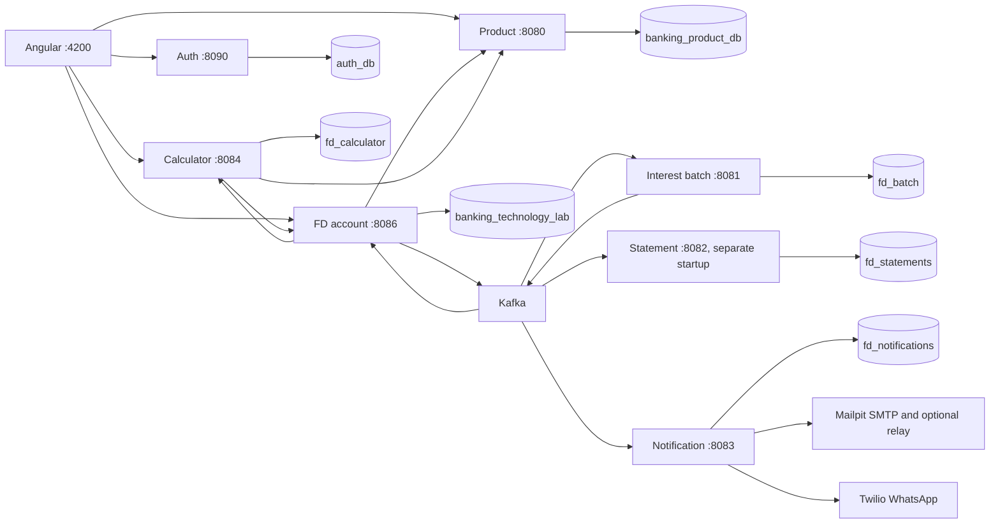

# FD architecture and deployment

This describes the current integrated repository. Azure is a proposed deployment target, not a completed deployment. Build and startup instructions are in the [root usage guide](../../usage.md).

## 1. Architecture

The browser calls services directly; no API gateway is deployed. Each service owns its schema, though four Group 9 schemas share a MySQL server. The root stack has six Java service containers; statement-service is available as a separate module/process.

## 2. Data and events

Accounts, profiles, nominees, bundle applications, transactions, interest state/history, business clock and event outbox live in `banking_technology_lab`. Product validation/rates come from the Product service; the legacy local `products` table is not the authoritative product catalog. Login credentials live in `auth_db`.

The outbox records events in the business transaction. A relay publishes pending events every three seconds and marks them published after acknowledgment. Consumers deduplicate event IDs; delivery remains at least once. Failed records receive one initial attempt and up to four retries before a matching `.DLT`; `InvalidEventException` is non-retryable. See [event contracts](EVENT_CONTRACTS.md).

Daily interest accrual creates a double-entry journal row debiting interest expense and crediting interest payable. Capitalization transfers interest payable to FD deposit liability; payouts, maturity and premature withdrawal settle the payable. Settlements use internal GL clearing codes and do not move money through an external payment system.

## 3. Security

Auth_Sec stores BCrypt users and refresh tokens in MySQL. Shared JWT validation checks HS256 signature, issuer and timestamps. Root Compose supplies development secrets; standalone auth requires configuration. Roles and ownership checks are endpoint-specific, not an ADMIN inheritance model. See [authentication](../AUTHENTICATION_SYSTEM.md).

CSV output escapes potentially executable cell prefixes. Notification recipients are masked in the log's recipient column; contact records and message bodies are stored separately. This is not a claim that all personal data is encrypted or masked.

## 4. Schedules and time travel

Daily accrual commands run at 03:00 IST for the previous real IST day. Maturity runs at 04:00 IST and extracts at 05:30 IST. Accrual notification batches flush every 30 seconds.

`POST /api/fd/clock/advance` adds days to the business-date offset and triggers accrual/maturity. The current controller permits all three roles. Reset clears the offset without undoing transactions. Root Compose defaults time travel on; the application default is off. Cron triggers and batch-service date validation use real time; the batch's `app.time-travel.max-days-ahead` is configured separately. Account product effective-date checks use its business clock; Product service validation uses its own date.

## 5. API and event versioning

FD lifecycle routes use `/api/fd`, reports `/api/report`, charts `/api/charts`, and integration routes `/api/v1/integration`. Product accepts `/api/product` and `/api/v1/products`; Calculator uses `/api/v1/fd`. Events use `schemaVersion: 1`.

## 6. Verification and limitations

Tests live under each module's `src/test`. Run the commands in the root usage guide. Historical 148-test/84-check reports and old lifecycle scripts predate the present integrated layout and are not current pass evidence.

Key limits: simulated payment settlement; in-memory account-number sequences; in-memory notification accrual batching; external notification sends not atomic with DB commits; failed sends not automatically replayed. Kafka/MySQL are development single-node deployments. Multiple extract-serving instances need shared storage. Existing database volumes need explicit migrations when schema changes.

## 7. Deployment

Use root `docker-compose.yml`. It defines MySQL 8.0 containers, Confluent Platform Kafka image 7.5.0 with ZooKeeper, Mailpit, and six backend services. The older module `compose.yaml` uses a different Kafka/MySQL setup and references a removed auth Docker target; do not use its full profile as current integrated startup instructions.

Group 9's Dockerfile uses Java 21, non-root runtime users, prebuilt service JARs, and Python dependencies for reports. Auth_Sec also copies prebuilt JARs. Build Maven artifacts before rebuilding those images.

Azure remains a design proposal: container images in a registry, individually deployed services, managed MySQL, a Kafka-compatible event service and managed secrets. Provisioning, compatibility testing, costs and production operations are outside the implemented local stack. No Azure deployment or current pricing is asserted here.
