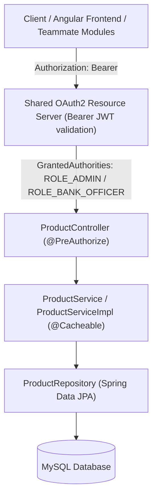

# Banking Product & Pricing Backend Module: Solution Document

**Derived from**: Lab L5 (Product & Pricing APIs), Lab L9 (Login/JWT Integration), and Lab L13 (FD Account Creation Integration).  
**Scope**: Backend (Spring Boot 3.3.4 + Java 21 + MySQL + Spring Security + JJWT + OpenAPI 3).  

---

## 1. Executive Summary & Architecture

The **Product & Pricing Module** serves as the single enterprise source of truth for all banking products (`FD`, `TD`, `CASA`, `LOAN`, `SAVINGS`). It enforces banking lifecycle rules, parameter limits, interest rate formulas, and multi-layered security. External consumers (such as the FD Account Module and Calculator) access product metadata and pricing **via REST APIs with both `/api/product` and `/api/v1/products` aliases**.



---

## 2. Security & Role-Based Access Control (Lab L9)

### 2.1 JWT Verification Flow
- **Stateless Session**: Configured with `SessionCreationPolicy.STATELESS`.
- **Token Format**: Standard HS256 symmetric signed JWT.
- **Header**: Requests require `Authorization: Bearer <token>`.
- **Claims Extracted**:
  - `sub`: Username (used for automatic audit tracking in `ooo_user_id` / `updated_by`).
  - `roles`: Extracted and mapped to Spring Security `ROLE_ADMIN`, `ROLE_BANK_OFFICER`.

### 2.2 Role Authorization Matrix

| Endpoint | Method | Required Role | Description |
|---|---|---|---|
| `http://localhost:8090/api/auth/login` | POST | Public | Central Auth_Sec login (separate service) |
| `/actuator/health` | GET | Public | Health and observability |
| `/swagger-ui/**`, `/api-docs/**` | GET | Public | OpenAPI documentation UI |
| `/api/product` | POST | `ROLE_ADMIN`, `ROLE_BANK_OFFICER` | Create new banking product |
| `/api/product/{code}` | PUT | `ROLE_ADMIN`, `ROLE_BANK_OFFICER` | Update product details |
| `/api/product/{code}` | DELETE | `ROLE_ADMIN`, `ROLE_BANK_OFFICER` | Soft retire product (`RETIRED`) |
| `/api/product/{code}` | GET | `ROLE_ADMIN`, `ROLE_BANK_OFFICER`, `ROLE_CUSTOMER` | Get product details |
| `/api/product/search` | GET | `ROLE_ADMIN`, `ROLE_BANK_OFFICER`, `ROLE_CUSTOMER` | Search with filters & pagination |
| `/api/product/active` | GET | Public | Dropdown feed for active products |
| `/api/product/{code}/validate` | GET | `ROLE_ADMIN`, `ROLE_BANK_OFFICER`, `ROLE_CUSTOMER` | FD module account pre-validation |
| `/api/product/{code}/rate` | POST | `ROLE_ADMIN`, `ROLE_BANK_OFFICER`, `ROLE_CUSTOMER` | Determine final calculated rate |
| `/api/product/{code}/defaults` | GET | `ROLE_ADMIN`, `ROLE_BANK_OFFICER`, `ROLE_CUSTOMER` | Auto-populate FD creation form |

---

## 3. Product APIs (Lab L5)

### 3.1 Create Product
- **Endpoint**: `POST /api/product`
- **Security**: `@PreAuthorize("hasAnyRole('BANK_OFFICER','ADMIN')")`
- **Sample Request**:
```json
{
  "productCode": "FD001",
  "productName": "Fixed Deposit - Short Term",
  "productType": "FD",
  "currency": "INR",
  "effectiveDate": "2025-07-01",
  "status": "ACTIVE",
  "termLimit": { "min": 3, "max": 36 },
  "rateLimit": { "min": 5.0, "max": 7.5 },
  "interestType": "CREDIT",
  "minAge": 18,
  "minDeposit": 5000.0,
  "maxDeposit": 10000000.0,
  "charges": {
    "interestCreditFrequency": "MONTHLY",
    "taxDeduction": true,
    "withdrawalFees": 1.5
  },
  "allowedRoles": ["OWNER", "CO_OWNER", "NOMINEE"],
  "rateVariations": [
    { "customerCategory": "SENIOR_CITIZEN", "rateModifier": 1.0 },
    { "customerCategory": "EMPLOYEE", "rateModifier": 0.5 }
  ]
}
```
- **Response**: `201 Created`
```json
{
  "productId": 1,
  "productCode": "FD001",
  "productName": "Fixed Deposit - Short Term",
  "productType": "FD",
  "currency": "INR",
  "effectiveDate": "2025-07-01",
  "status": "ACTIVE",
  "termLimit": { "min": 3, "max": 36 },
  "rateLimit": { "min": 5.0, "max": 7.5 },
  "interestType": "CREDIT",
  "minAge": 18,
  "minDeposit": 5000.0,
  "maxDeposit": 10000000.0,
  "createdBy": "bank_admin",
  "createdAt": "2026-10-06T23:30:00"
}
```

### 3.2 Update Product
- **Endpoint**: `PUT /api/product/{productCode}`
- **Security**: `@PreAuthorize("hasAnyRole('BANK_OFFICER','ADMIN')")`
- **Sample Request**:
```json
{
  "productCode": "FD001",
  "productName": "Fixed Deposit - Ultra Short Term",
  "productType": "FD",
  "currency": "INR",
  "status": "ACTIVE",
  "rateLimit": { "min": 5.5, "max": 8.0 }
}
```
- **Response**: `200 OK`

### 3.3 Search Products with Filters & Pagination
- **Endpoint**: `GET /api/product/search?productType=FD&startDate=2025-01-01&endDate=2025-12-31&page=0&size=10&sortBy=productId`
- **Security**: `@PreAuthorize("hasAnyRole('BANK_OFFICER','ADMIN','CUSTOMER')")`
- **Response**: `200 OK` (List of `ProductResponseDTO`)

---

## 4. FD Module Integration APIs (Lab L13)

### 4.1 Validate Product for Account Creation
- **Endpoint**: `GET /api/product/{productCode}/validate?termMonths=12&amount=50000&age=30`
- **Description**: Validates that the product is `ACTIVE`, within effective dates, and requested term, amount, and age meet product business constraints.
- **Sample Output (`200 OK`)**:
```json
{
  "valid": true,
  "productCode": "FD001",
  "productName": "Fixed Deposit - Short Term",
  "status": "ACTIVE",
  "message": "Product configuration and criteria validated successfully for account creation",
  "effectiveDate": "2025-07-01",
  "termMonths": 12,
  "amount": 50000.0,
  "age": 30,
  "minTerm": 3,
  "maxTerm": 36,
  "minDeposit": 5000.0,
  "maxDeposit": 10000000.0,
  "minAge": 18
}
```
- **Error Behavior**:
  - Product inactive / expired -> `422 Unprocessable Entity` (`PRODUCT_INACTIVE`)
  - Out of range term / amount / under minimum age -> `400 Bad Request` (`INVALID_PRODUCT`)

### 4.2 Determine Final Interest Rate
- **Endpoint**: `POST /api/product/{productCode}/rate`
- **Description**: Calculates the effective interest rate by adding customer category bonus (e.g. Senior Citizen +1.0%, Employee +0.5%) to the product base rate, clamped strictly between `minRate` and `maxRate`.
- **Sample Request**:
```json
{
  "termMonths": 12,
  "customerCategory": "SENIOR_CITIZEN",
  "age": 65
}
```
- **Sample Output (`200 OK`)**:
```json
{
  "productCode": "FD001",
  "productName": "Fixed Deposit - Short Term",
  "termMonths": 12,
  "customerCategory": "SENIOR_CITIZEN",
  "baseRate": 5.5,
  "rateModifier": 1.0,
  "finalRate": 6.5,
  "minRateLimit": 5.5,
  "maxRateLimit": 7.5
}
```

### 4.3 List Active Products (Dropdown Feed)
- **Endpoint**: `GET /api/product/active?type=FD`
- **Output**: Array of active products for dropdown selection in the FD account opening wizard.

### 4.4 Get Product Account Defaults
- **Endpoint**: `GET /api/product/{productCode}/defaults`
- **Output**: Default term, default deposit amount, default interest rate, allowable roles, and charges for populating account forms.

---

## 5. Standardized Error Handling Matrix

Controller business exceptions are intercepted by `GlobalExceptionHandler` and return a unified JSON payload:

```json
{
  "timestamp": "2026-10-06T23:30:00",
  "status": 409,
  "errorCode": "DUPLICATE_PRODUCT",
  "message": "Product code FD001 already exists",
  "path": "/api/product"
}
```

| HTTP Status | Error Code | Trigger Condition |
|---|---|---|
| `400 Bad Request` | `VALIDATION_FAILED` | Bean Validation constraint violation (`@NotBlank`, `@Pattern`, etc.) |
| `400 Bad Request` | `INVALID_PRODUCT` | Range rule violation (`minTerm > maxTerm`, `minDeposit > maxDeposit`) |
| `401 Unauthorized` | `UNAUTHORIZED` | Missing or invalid JWT Bearer token |
| `403 Forbidden` | `FORBIDDEN` | Authenticated user lacks required role (e.g. Customer creating product) |
| `404 Not Found` | `PRODUCT_NOT_FOUND` | Product code does not exist in the database |
| `409 Conflict` | `DUPLICATE_PRODUCT` | Attempt to register an already existing `productCode` |
| `422 Unprocessable`| `PRODUCT_INACTIVE` | Attempting to validate or create accounts on `INACTIVE`, `SUSPENDED`, or expired products |

---

## 6. Deliverables Reference

- **OpenAPI 3.0 Specification**: [`openapi.json`](openapi.json)
- **Postman Collection**: [`postman_collection.json`](postman_collection.json)
- **End-to-End Smoke Test Script**: [`smoke_test_endpoints.sh`](smoke_test_endpoints.sh)
- **Database Schema**: [`schema.sql`](schema.sql)
- **Seed Data**: [`insert_dummy_data.sql`](insert_dummy_data.sql)
